# Utility Knowledge Graph v3 — CIM-aligned, configurable GraphRAG

A configurable knowledge-graph application for power utilities. It starts from **three inputs only** — SQL DDL, an
OWL/RDF ontology (TTL) and data files — and builds an IEC CIM-aligned Neo4j knowledge graph with GIS, a semantic (CIM)
layer, narrative chunks and GraphRAG question answering. Data generation and ingestion are **not** part of the
application: the data in `input/data` was generated once and is only read.

- **Why and what for:** `docs/01_Utility_KG_Research_and_Use_Cases.md` — what Enel, State Grid, China Southern Power Grid,
  SPEN, Statnett, SCE, OTEC, EDF, Alliander and E.ON publish about knowledge graphs, the common challenges, the top 10
  use cases on the CMM data model, and why **asset, distribution, transmission, GIS and outage** are the first five domains.
- **Data model:** `input/data_model/ddl` (468-table Databricks DDL, 2,844 FKs) and `input/data_model/ttl` (CMM ontology
  sub-classing IEC CIM100, CIM reference subset, SKOS subject areas, GeoSPARQL alignment), copied from
  `utility-cmm-canonical-dm/cmm-aligned-can-dm`.
- **Data:** `input/data` — 46 tables, 3,405 rows, fictional utility with real WGS84 geometry (see `input/data/README.md`).

## Architecture

```mermaid
flowchart LR
    subgraph IN[input - read only]
        DDL[data_model/ddl/*.sql]
        TTL[data_model/ttl/*.ttl<br/>CMM ontology + CIM subset + SKOS + GeoSPARQL]
        DATA[data/&lt;schema&gt;/&lt;table&gt;.csv]
    end
    subgraph M["step: model (offline)"]
        P[generic DDL parser<br/>tables, PKs, FKs, enums, patterns]
        R[typed data reader + validation<br/>PK, FK orphans, NOT NULL, enums, WGS84]
        O[ontology extractor<br/>table→class, column→property→CIM attribute,<br/>FK→object property→CIM association]
        S[build/semantic_model.json<br/>build/ontology_subset.ttl<br/>build/graph_schema.json]
    end
    subgraph L[step: load]
        W[structured load - MERGE writer<br/>labels: class + CIM_* ; props: cim_class, cim_match, mRID]
        PL[polymorphic links<br/>Terminal→equipment, GIS feature→record]
        G[GIS: geo_point + SF_WITHIN / SF_INTERSECTS]
        D[derived: FEEDS from CIM terminals,<br/>REGISTERED_AS identity]
        SEM[semantic layer: OntologyClass→CimClass<br/>→CIM hierarchy, properties→CIM attributes]
        U[narratives → Document/Chunk + embeddings<br/>optional LLM extraction]
        I[vector, full-text, point indexes]
    end
    subgraph Q[step: rag + ui]
        T2C[Text2Cypher<br/>CIM-annotated schema + few-shot]
        VC[Vector + graph]
        HC[Hybrid + graph]
        UI[Web UI: chat, evidence graph<br/>CIM overlay + geo layout,<br/>Model & CIM explorer, trace]
    end
    subgraph V[step: viz]
        H[overview, CIM alignment, schema,<br/>GIS map, per-question subgraphs]
    end
    DDL --> P --> R
    DATA --> R
    TTL --> O
    P --> O --> S
    R --> W
    S --> W --> PL --> G --> D --> SEM --> U --> I --> NEO[(Neo4j 5.13+ / APOC)]
    NEO --> T2C & VC & HC --> UI
    NEO --> H
```



| Package | Responsibility |
|---|---|
| `ukg/model/` | `ddl.py` generic DDL parser (any dialect with `CREATE TABLE` / `ALTER TABLE ... FOREIGN KEY`); `data.py` typed CSV/JSONL reader; `validate.py` read-only data checks |
| `ukg/ontology/` | `extract.py` semantic model from the TTL (class, CIM alignment, column and FK mappings), ontology subset; `schema.py` neo4j-graphrag `GraphSchema` and the CIM-annotated Text2Cypher schema |
| `ukg/kg/` | Neo4j client, MERGE writer with CIM labels, structured + polymorphic load, GIS points and spatial relations, derived relationships, semantic layer, narratives/embeddings, indexes |
| `ukg/rag/` | providers (OpenAI, Azure, Anthropic, Ollama, OpenAI-compatible), config-driven retrieval templates, question runner, report |
| `ukg/viz/` | HTML renderings (overview, CIM alignment, schema, GIS map, question subgraphs) |
| `ukg/ui/` | FastAPI server, QA engine (routing, fallback, evidence graph, trace), static front end |

### How the IEC CIM standard shows up

- **Every data node** carries `cim_class`, `cim_match` (exact / close / broad / extension), `cim_package`, `cim_standard`,
  `subject_area`, `source_table` and its CIM `mrid`, plus labels for its CIM class and superclasses
  (`:Feeder:CIM_Feeder:CIM_EquipmentContainer:CIM_ConnectivityNodeContainer:CIM_PowerSystemResource`). So
  `MATCH (n:CIM_PowerTransformer)` finds distribution *and* power transformers.
- **Every FK relationship** carries the CIM association role (`cim_association: 'Feeder.Substation'`).
- **The semantic layer** is in the graph: `(:OntologyClass)-[:SPECIALIZES {match}]->(:CimClass)-[:SUBCLASS_OF*]->(:CimClass {name:'IdentifiedObject'})`,
  `(:OntologyClass)-[:HAS_PROPERTY]->(:OntologyProperty {unit})-[:MAPS_TO]->(:CimAttribute {name:'BaseVoltage.nominalVoltage'})`,
  `(data node)-[:INSTANCE_OF]->(:OntologyClass)`.
- **CIM topology**: `gis.terminal` / `gis.connectivity_node` (CIM `Terminal` / `ConnectivityNode`) are resolved into
  `FEEDS` (load-side terminal → source-side terminal on the same node; normally-open switches do not feed through).
- **Visualisation**: the evidence graph has a *CIM classes* overlay and a node card listing CIM class, match, package,
  standard, mRID and each property's CIM attribute and unit; the *Model & CIM* page shows every class, its CIM chain,
  column → CIM attribute mappings and FK → CIM associations; `output/cim_alignment.html/.svg` draws the alignment.
- **GIS**: WGS84 `geo_point` on every located node, `SF_WITHIN` / `SF_INTERSECTS` to HFTD, storm and territory polygons
  (GeoSPARQL simple-feature semantics), a *Geo* layout in the evidence graph and a Leaflet map (`output/gis_map.html`).

## Setup

```bash
cd utility-knowledge-graph-v3
python -m venv .venv
.venv\Scripts\activate            # Windows  (macOS/Linux: source .venv/bin/activate)
pip install -r requirements.txt
```

**Neo4j** 5.13+ (Neo4j Desktop DBMS recommended) with the **APOC** plugin, started. A dedicated database
(`NEO4J_DATABASE=utility-kg-v3`) is created automatically when missing (Enterprise / Desktop developer licence); on
Community use `neo4j`.

**`.env`**: copy `.env.example` to `.env` and fill in Neo4j, LLM and embedding settings. Any of `openai`,
`openai_compatible`, `azure_openai`, `anthropic` (LLM only), `ollama` works; LLM and embedder are configured separately.
The defaults use local Ollama (`qwen2.5:7b`, `nomic-embed-text`).

## Run

```bash
python -m ukg run --step all          # model -> load -> rag -> viz
python -m ukg ui                      # http://127.0.0.1:8502
```

| Command | What it does | Needs |
|---|---|---|
| `python -m ukg run --step model` | parse DDL + data + TTL, validate data (`output/data_validation.json`), write `build/semantic_model.json`, `build/ontology_subset.ttl`, `build/graph_schema.json` | nothing (offline) |
| `python -m ukg run --step load` | constraints, structured + polymorphic load, GIS points, spatial and derived relationships, CIM semantic layer, narrative chunks + embeddings, indexes (`output/load_summary.json`) | Neo4j, embedder |
| `python -m ukg run --step rag` | answer the 10 demo questions with every retriever; deterministic ground truth; `output/report.md` | Neo4j, LLM, embedder |
| `python -m ukg run --step viz` | `output/graph_overview.html`, `cim_alignment.html/.svg`, `schema_overview.html/.svg`, `gis_map.html`, `q*_subgraph.html` | Neo4j |

Flags: `--reset` empties the database first, `--skip-text` loads without embeddings/LLM, `--question Q4` runs one
question, `--config path/to/config.yaml` (or `UKG_CONFIG`) uses another configuration, `-v` debug logging.

## Web UI

| Area | What it shows |
|---|---|
| **Chat** | Conversation, retriever picker (Auto routes each question; Compare runs all three), *Browse questions* (10 demo questions, one per use case, plus recommended ones) |
| **Detailed answer** | Full answer, retriever, timings, fact check against the input data for demo questions |
| **Evidence graph** | Records behind the answer, coloured by subject area. *Network / Geo* layout (Geo places nodes at their WGS84 coordinates), *CIM classes* overlay, node card with CIM class, package, standard, mRID and CIM attribute + unit per property |
| **How it was checked** | Live trace: routing, retrieval (generated Cypher or retrieval query), context, generation, evidence graph, verification with ground-truth Cypher |
| **Model & CIM** | Semantic-model browser (works before the graph is loaded): classes by subject area, CIM specialisation chain, columns → CIM attributes, relationships → CIM associations, sample instances |

## Demo questions (one per use case)

| # | Use case | Question (short) | Retriever | Expected (from the input data) |
|---|---|---|---|---|
| Q1 | UC1 topology | What is downstream of recloser PRD1201-R1? | Text2Cypher | S02–S04, T02–T06, 2 DER, D1/F1/C1/TIE; 141 customers |
| Q2 | UC2 outage | Cause, isolation, actions and ETR history of OE-2025-0115 | Hybrid + graph | VEG, R1, 141 customers, D1 open → tie closed (48) → repair → R1 closed (93); ETR 08:00→12:00→16:00→15:05 |
| Q3 | UC3 asset health | Transformer failures preceded by an inspection finding | Vector + graph | CFL2101-T04: INS-2024-DT-0412 → FE-2025-0012 → OE-2025-0311 → WO-2025030211 tree, USD 27,000 |
| Q4 | UC4 wildfire | Lines/feeders in HFTD Tier 3 with vegetation history | Text2Cypher | GPK-LKV-230-1, GPK-OKH-115-1 (intersect); PRD1201, PRD1202 (within) |
| Q5 | UC5 T–D | What depends on Granite Peak 230kV? | Text2Cypher | Pine Ridge + Cedar Flat, 4 feeders, 546 customers; GPKT2PT01 critical |
| Q6 | UC6 storm | Winter Storm Kestrel events, damage, crews | Text2Cypher | 6 events; OE-2025-0115 largest |
| Q7 | UC7 DER | Where can 2 MW of solar connect near (38.62, -120.99)? | Text2Cypher | WLB5101 (4.9 km, 4.05 MW), WLB5102 (5.1 km, 5.70 MW) |
| Q8 | UC8 reliability | SAIDI ranking with/without Major Event Days | Text2Cypher | CFL2101/PRD1201/PRD1202 incl. MED; MLC4101/CFL2101/WLB5102 excl. |
| Q9 | UC9 GIS DQ | GIS features and transformers that do not reconcile | Text2Cypher | 3 orphan features, 2 mRID mismatches, 2 no location, 2 no registry, 1 coordinate offset |
| Q10 | UC10 clearance | Is the SC-2025-0042 work zone isolated? | Text2Cypher | R1 and D1 tagged; F1 never operated, battery POI-PRD1201-02 beyond it |

## Plugging in another model

Nothing in the code names a CMM table, column or class. To run on another model:

1. Put its DDL, TTL and data files anywhere and point `input` in `config.yaml` at them (`path_template`, `format`).
2. Set `scope.domains` (schema → tables, or `"*"`).
3. If its ontology uses other annotation properties, change `ontology.annotations` / `standard_matches` /
   `standard.namespace`; without annotations, classes and properties resolve by naming convention
   (`PascalCase(table)`, `Class.camelCase(column)`) and FKs by column name.
4. Adjust `graph.caption_property` / `summary_properties` (optional — auto-detected otherwise),
   `graph.polymorphic_links` and `graph.derived_relationships` (optional), `gis` columns, `rag.templates`, and write
   `user_questions/questions.yaml` for the new domain.
5. `python -m ukg run --step all`.

## Limitations

- **Synthetic data.** Small, planted, deterministic; statistics are illustrative. Each modelled transformer stands for
  a transformer zone (dozens of customers).
- **LLM-dependent steps.** Text2Cypher with a small local model can produce wrong Cypher; Auto mode falls back to
  hybrid search and the trace shows it. Ground-truth Cypher and the fact check make the difference visible.
- **Spatial relations** are computed in Python with simple-feature tests on WGS84 coordinates (no geodesic buffers);
  H3 cells are not populated.
- **Polymorphic references** that point to missing records are reported (data-quality findings), not loaded.
- **Relationship deletion.** Re-runs MERGE nodes and relationships; rows removed from the inputs are not deleted — use `--reset`.
- **Neo4j Community** has a single database (`neo4j`).
